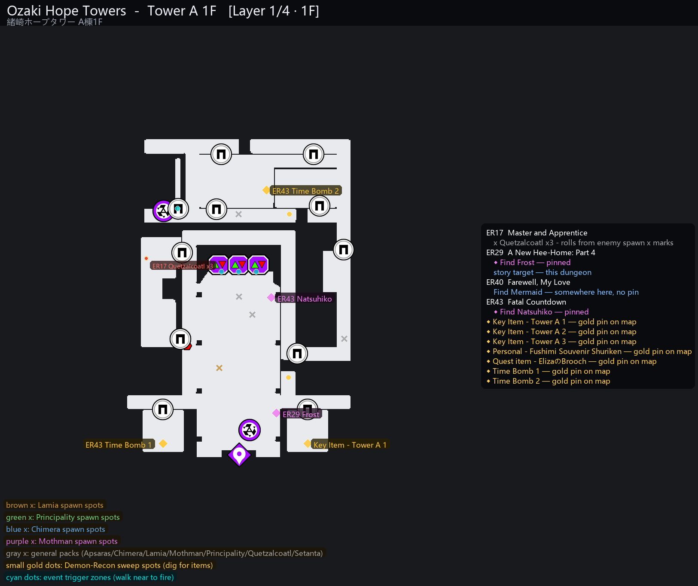

# SH2 Maps — Soul Hackers 2 automap extractor

Accurate, multi-floor, fully-labelled minimaps for **Soul Hackers 2** (2024),
generated straight from the game's own data files by a reproducible Python
pipeline.



Every pixel and every pin is extracted, not hand-placed: the renderer lifts
the same auto-map tile textures the in-game minimap uses (256×256 BC7 tiles),
fits Unity scene-space → image-space transforms, reconstructs multi-floor
dungeons (including stacked buildings where one world-Y mixes several
floors), and overlays only data-backed objects: portal destinations,
item-reaction (`Points_DevilSearch`) and event (`Points_Event`) coordinates,
NPC pins, enemy/normal-encounter spawn packs and boss arenas.

> **Disclaimer:** this repository contains **no game assets**. The tools need
> your own legally-purchased copy of the game; the committed map outputs are
> generated locally from such a copy and may not be redistributed by others.

## Highlights

- **69 per-floor maps** (`out/maps_v2/` + `INDEX.md`), floors labelled
  `L0` = top.
- **Portal labels are warp-label corridor matches** — destination text placed
  on the corridor that actually warps, not guessed from icons.
- **Object pins are ground truth**: `map_resident_data` MonoBehaviours carry
  the real world positions of every recon item, event trigger and spawn.
- **Multi-floor solver** for stacked buildings (du007-style), with manual
  layer-label overrides where the game's own data is ambiguous.
- Legend colours match the map symbols 1:1; labels are collision-avoided.

## Quickstart

You need Python 3.12+ and a Windows install of Soul Hackers 2 (Steam paths
are auto-detected; override with `SH2_GAME_DIR`).

```bash
python -m venv .venv && .venv/Scripts/activate      # or source .venv/bin/activate
pip install -r requirements.txt

# 1) pull the automap tile textures for your dungeon(s)
python tools/dump_automap.py du001 du004

# 2) render a map (dungeon, area, output png; --all = per-floor PNGs + stack)
python tools/build_minimap_layers.py du004 0000 out/maps_v2/du004_0000_L0.png --all
```

The committed `out/maps_v2/` folder lets you browse the results immediately
without running anything.

Optional data-mining chain (feeds the richer map overlays):

```bash
python tools/find_encrypted.py            # scan game files for AES-CTR data
python tools/decrypt_all.py               # decrypt win/Message + commontable
python tools/msg_dump.py                  # label -> localized text caches
python tools/dump_commontable.py          # structured JSON of the game tables
python tools/commontable_digest.py        # joined, readable digests
python tools/extract_map_resident_data.py # object/event/spawn coordinates
python tools/coverage_report.py           # quest-objective location coverage
```

## How it works

```
game bundles ──dump_automap──▶ BC7 tile bins ─┐
             ──UnityPy──▶ UI tree + transforms├─▶ build_minimap_layers ─▶ PNGs
       decrypted data ─▶ object/event points ─┘
```

The deep dive (file formats, the AES-CTR scheme, the layer-stacking solver,
evidence for every claim) lives in [`docs/DATA.md`](docs/DATA.md);
[`docs/DEVELOPMENT-LOG.md`](docs/DEVELOPMENT-LOG.md) is the raw research log.

## Repository layout

```
tools/          the pipeline (each script is standalone, run from repo root)
tools/data/     cached scene/transform metadata (regenerable, committed)
out/maps_v2/    final per-floor maps + INDEX.md
out/*.json      coordinate/transform caches consumed by the renderer
out/digest/     joined JSON game-data digests
docs/           DATA.md (full write-up) + DEVELOPMENT-LOG.md (chronological)
```

## Notes & known issues

- `du004_0010` L0/L4 are genuinely near-identical in the game's data
  (in-game check pending).
- Field-area (`fi*`) minimaps are not rendered: the game ships no automap
  tiles for them.

## License

MIT for the code (see `LICENSE`). Generated outputs are derived from game
assets you own — treat them accordingly.
